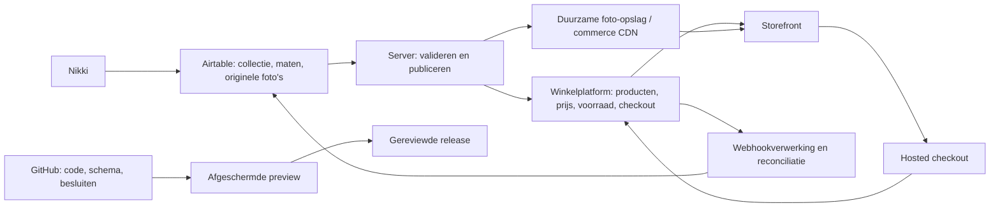

# Architectuurvoorstel

Status: voorstel voor implementatie; alleen Airtable en de documentatiefundering zijn nu ingericht.

## Gegevensstroom

De aanbevolen combinatie is een dunne Next.js/TypeScript storefront met Shopify-checkout en een server-side Airtable-publisher. Dat geeft ruimte voor een eigen collectie- en meetervaring. Een Shopify-theme met dezelfde Airtable-invoer is minder werk en blijft een serieuze optie zolang vormgeving en budget openstaan. Er is nog geen platform aangeschaft of runtime geïnstalleerd.

Een alternatief met een eigen transactionele database en betaalprovider brengt zelf te bouwen reserveringen, orderafhandeling en herstelwerk mee. Dat past niet bij deze eerste fase.

## Eén eigenaar per gegeven

| Gegevens | Hoofdbron | Andere systemen |
|---|---|---|
| SKU, omschrijving, materiaal, staat, maten, fotoselectie | Airtable | Goedgekeurde kopie in storefront/commerce |
| Voorgestelde nieuwe prijs | Airtable, Draft price minor | Alleen via expliciete publicatie naar commerce |
| Actuele verkoopprijs en valuta | Winkelplatform | Storefront leest deze; checkout beslist |
| Verkoopbare voorraad, reservering, order, betaling | Winkelplatform | Airtable heeft alleen een statuskopie |
| Originele foto's | Airtable | Na goedkeuring kopie naar duurzame opslag |
| Code, schemawijzigingen, besluiten | GitHub | Lokale checkouts |
| Persoons- en betaalgegevens | Winkelplatform | Niet naar Airtable of repository kopiëren |

Geen vrije tweerichtingssynchronisatie. Een onverwachte prijswijziging in commerce wordt een conflict dat de publisher meldt. Veranderingen in tekst/maten mogen voorraad nooit terugzetten naar één. Gebruik SKU als stabiele externe sleutel en bewaar de echte product- en variant-ID's.

## Unieke voorraad

Eén SKU staat voor één kledingstuk en één verkoopvariant. De eerste voorraadinstelling naar één is een afzonderlijke, gecontroleerde handeling bij eerste publicatie; de publisher bewaart duurzaam dat deze initialisatie is uitgevoerd. Herhalingen en metadata-updates veranderen voorraad niet. De voorraadtelling staat aan en verkopen bij nul voorraad staat uit. Ook handmatige of offline verkopen lopen via dezelfde voorraadbron; een Airtable-vinkje is onvoldoende.

Bij toevoegen aan winkelmand en checkout de actuele commerce-uitkomst verwerken. Beschikbaarheid op een gecachete productpagina is indicatief. Bij onbereikbare of onbekende commerce-status wordt aankoop geblokkeerd; eventueel blijft de catalogus leesbaar.

Twee gelijktijdige kopers van hetzelfde stuk zijn een verplicht integratiescenario vóór lancering. Een browser-return van een betaling is geen bewijs van een betaalde order. Verwerk de bevestigde serverstatus. Een retour of annulering maakt een stuk niet automatisch opnieuw beschikbaar: eerst fysieke inspectie, daarna een bewuste herbevoorrading. Test ook platforminstellingen voor automatische restock.

Shopify ondersteunt voorraadtracking en een instelling voor doorverkopen bij nul; bij POS bestaan uitzonderingen, dus het operationele verkoopproces moet mee worden getest. [Shopify-documentatie](https://help.shopify.com/en/manual/inventory-and-locations/setup/selling-when-out-of-stock).

## Publicatie en herstel

1. Nikki markeert een record als ready. De server haalt het record, één meetset en goedgekeurde foto's op.
2. Valideer verplichte gegevens, unieke SKU/slug, koppelingen en meetmethode. Bij fouten niets publiceren en een concrete herstelmelding opslaan.
3. Maak een hash van alleen de goedgekeurde inhoud. Gebruik een duurzame jobadministratie met unieke sleutel `(SKU, content-hash)` en een lock per SKU.
4. Kopieer foto's naar duurzame hosting en schrijf productgegevens naar commerce. Bewaar eerst platform-ID's voordat een vervolgstap start. Een herhaalde job herkent bestaande producten en uploads.
5. Pas na geslaagde stappen de publicatiestatus en timestamp bijwerken. Bij gedeeltelijke fouten alleen de ontbrekende stap hervatten; nooit een tweede product creëren of voorraad resetten.
6. Commerce-events verifiëren op authenticiteit, met uniek event-ID vastleggen, daarna verwerken. Dubbele events zijn onschadelijk. Bij vertraagde events de actuele commerce-status opnieuw ophalen zodat een oud event de status niet terugdraait.
7. Een periodieke reconciliatie herstelt gemiste updates en meldt verschillen. Een storing in Airtable mag geen betaalde order verliezen.

De jobadministratie vraagt een klein duurzaam opslagmechanisme met transacties/unieke sleutels; aanbieder pas kiezen bij hosting. Dit is nog geen geïmplementeerde service. Een periodieke run wordt pas ingericht wanneer de runtime bestaat; er is nu geen automation aangezet.

Airtable heeft API-limieten. Batch waar mogelijk, pagineer volledig, gebruik backoff bij 429 en houd rekening met maandquota. Geen Airtable-call voor iedere bezoeker. [Airtable-limieten](https://support.airtable.com/articles/7735693959-managing-api-call-limits-in-airtable).

Airtable-downloadlinks voor bijlagen verlopen. Gebruik ze voor overdracht en bewaar in de winkel een duurzame media-URL. [Airtable-bijlagen](https://support.airtable.com/articles/9671148410-airtable-attachment-url-behavior).

## Omgevingen en geheimen

Ontwikkeling gebruikt synthetische fixtures. Preview krijgt een aparte testbase en testwinkel zodra die bestaan. Productie heeft eigen secrets en configuratie. De nieuw aangemaakte base is de collectiebase; er staat nog geen voorraad in.

Alle Airtable- en commerce-adminsleutels blijven op de server. Geen sleutels in publieke browservariabelen, Git, screenshots, prompts of logs. Browserpayloads gebruiken een expliciete lijst met publieke velden; kosten, opslaglocatie, herkomstnotities en syncfouten vallen daarbuiten. Server- en browsercode worden bewust gescheiden. [Next.js server/client-grens](https://nextjs.org/docs/app/getting-started/server-and-client-components).

Voorgestelde latere code-indeling: `src/app/` voor de winkel, `src/server/airtable/`, `src/server/commerce/`, `src/server/publishing/` en `src/domain/` voor gevalideerde publieke modellen. Maak die pas aan bij de gekozen implementatie. API-versies en dependencies dan expliciet vastleggen en testen; niet automatisch 'latest' gebruiken.
