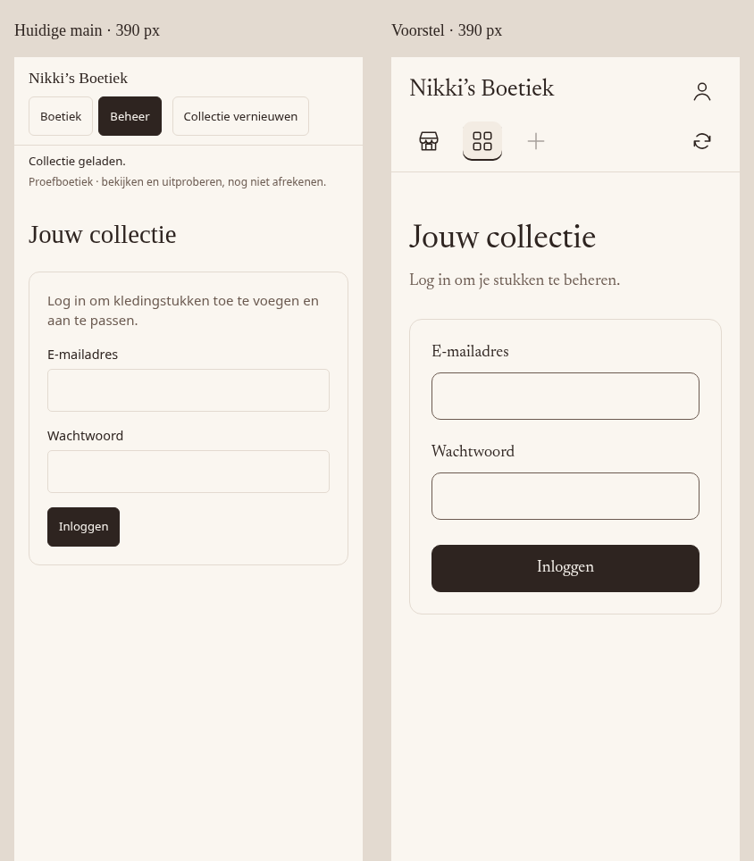
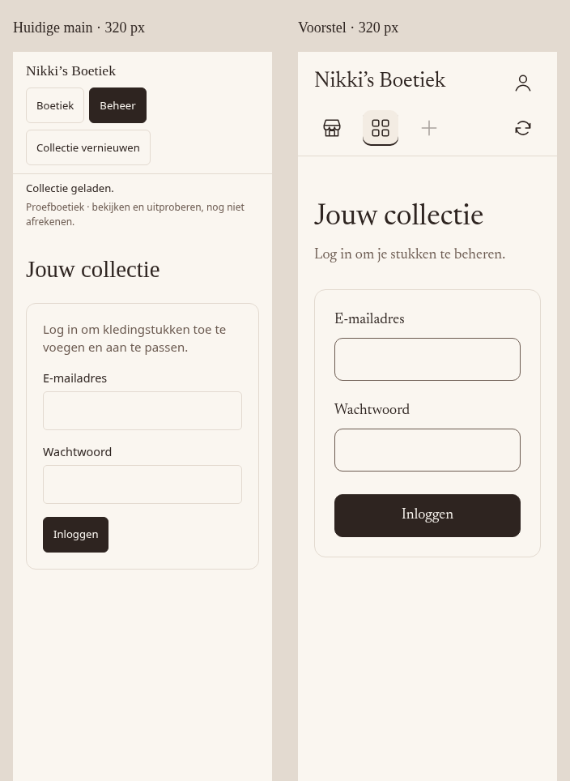
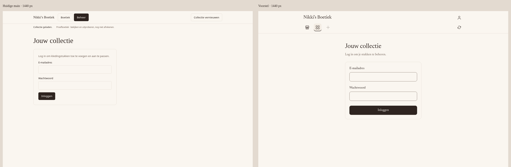
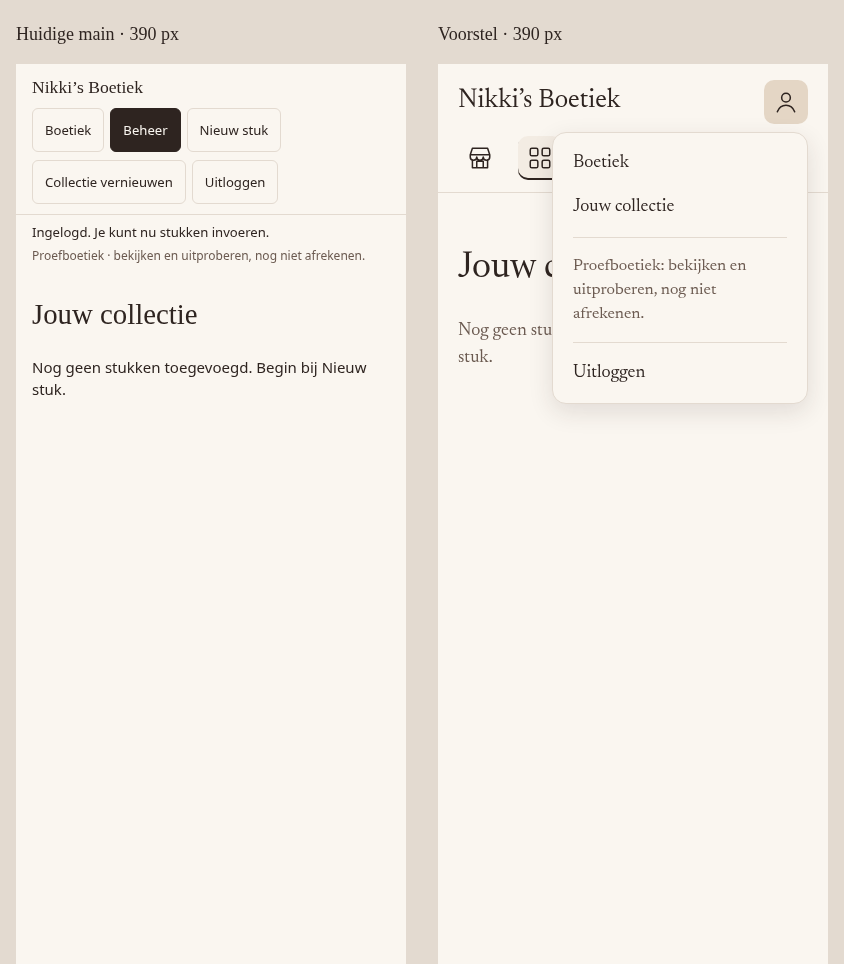

# Stap 1 — bovenbalk en inloggen ter beoordeling

**Status: voorstel, wacht op Martijn. Nog geen implementatie in de app.**

Eigenaar: Codex. Basis: nieuwste opgehaalde `main`, `61fe553` (11 november 2026). Branch: `codex/beheer-stap-1-ontwerp`. De [ontwerpbrief](BEHEER-ONTWERPBRIEF.md) en Martijns besluiten zijn leidend. De skills staan apart in [PR #31](https://github.com/martijnungerer-dot/NIkki-s-Vintage/pull/31). Deze branch bevat geen kopie van die skills en bouwt niet op hun oude ontwerpbranch.

## Vergelijkingen

Links steeds de huidige gebouwde app, rechts de losse mock. Viewporthoogte 900 px. Uitsluitend synthetische testdiensten; geen echte account- of collectiegegevens.

### 390 px



### 320 px



### Desktop, 1440 px



### Accountmenu, ingelogd



Ook beschikbaar: [menu op 320 px](screenshots/beheer-stap-1/vergelijking-menu-320.png), [menu op desktop](screenshots/beheer-stap-1/vergelijking-menu-1440.png), [foutmelding 390 px](screenshots/beheer-stap-1/fout-390.png), [foutmelding 320 px](screenshots/beheer-stap-1/fout-320.png), [lege staat 390 px](screenshots/beheer-stap-1/leeg-390.png) en [lege staat 320 px](screenshots/beheer-stap-1/leeg-320.png).

## Ontwerpkeuzes voor akkoord

- Twee vaste kopregels op alle schermen: merk en account boven; boetiek, collectie, + en vernieuwen eronder. Zo blijft elke knop 44 × 44 px, ook op 320 px. Geen hergroepering of verspringende volgorde op desktop.
- Account gebruikt het bestaande lijnicoon van optie B. De andere iconen hebben dezelfde 26 px maat en 1,4 px lijn. Boetiek en collectie krijgen een korte tooltip bij aanwijzen of toetsenbordfocus. Het accountmenu biedt beide bestemmingen ook met hun naam, zodat de betekenis op een telefoon op te zoeken is.
- Uitloggen en de proefmelding staan in het accountmenu. Er komt geen extra rij tekstknoppen. De + behoudt zijn plek vóór inloggen, maar is dan uitgeschakeld. De daadwerkelijke camera-aansluiting hoort bij stap 2.
- Newsreader, het roomkleurige vlak en de zachte ronde knoppen komen uit optie B. Het formulier is gecentreerd, met links uitgelijnde tekst, velden van 52 px en één volle knop **Inloggen**. De login blijft een gewone knop met tekst; de navigatie gebruikt iconen.
- Successtatus verdwijnt na vijf seconden; een inlogfout blijft onder de velden staan. De mock demonstreert de plaats en de focus, niet de uiteindelijke foutafhandeling van de app.

De twee kopregels en de menu-oplossing voor minder duidelijke iconen zijn expliciete ontwerpkeuzes ter beoordeling door Martijn.

## Gebruikte richting en review

Frontend Design is toegepast vóór het maken van de mock: één familie met de boetiek, rustige compositie, merknaam niet herhaald in het formulier, geen extra accentkleur, decoratieve beelden of animatie. Zelfkritiek: het room/serif-palet is hier de voorgeschreven stijlbron; een ander palet zou juist een tweede stijl introduceren.

Tokens: `--bg #FAF6F0`, `--fg #2E2420`, `--muted #6B5A50`, `--line #E3DAD0`, `--chip #F3ECE3`, `--chip-on #E4D6C5`. Newsreader 18 px basis, 16 px minimum, 26 px merk, 36 px kop. De bestaande app neemt kleuren via `syncStyle` over; bij implementatie blijft dat de bron.

UI UX Pro Max is met het Python-zoekscript geraadpleegd voor `icon button accessible label` (icons) en `form labels mobile` (ux). Passend: toegankelijke icoonnamen, decoratieve SVG's verbergen, zichtbare formulierlabels en feedback na verzenden. React-imports, andere iconenbibliotheken en afwijkende letteradviezen zijn niet overgenomen.

Web Design Guidelines zijn voor deze PR opnieuw opgehaald. Review van de mock:

- `concept/beheer-stap-1/index.html`: labels, autocomplete, invoertypen, icoonnamen, decoratieve SVG's, skiplink, status en foutmelding aanwezig.
- `concept/beheer-stap-1/style.css`: zichtbare focus, veilige schermranden, geen animatie, alle tekst minstens 16 px, aanraakvlakken minstens 44 px; visueel gecontroleerd op 390, 320 en 1440 px.
- `concept/beheer-stap-1/mock.js`: accountpaneel sluit via Escape, terugkeer van focus, sluit bij klikken/focussen buiten het paneel; formulierfout houdt focus bij de invoer.
- Beperking: navigatie naar boetiek/nieuw stuk is bewust geen werkende app-navigatie in een losse mock. Die knoppen moeten bij implementatie de bestaande `show()`- en invoerstroom blijven gebruiken. Geen URL/router- of frameworkwijziging nodig voor deze ontwerpfase.

## Zelf bekijken en reproduceren

Open [de mock](../concept/beheer-stap-1/index.html) lokaal, of serveer de repository met een lokale statische server. Varianten: standaard login, `?state=error`, `?state=empty`, `?state=menu`. Het formulier verstuurt niets, bewaart niets en toont na geldige invulling uitsluitend de voorbeeldfout. Gebruik geen echte inloggegevens. De plus en boetiekknoppen zijn visuele plaatsaanduidingen. Alleen het menu, de voorbeeldfout, uitloggen uit de mockstaat en de tijdelijke vernieuwmelding zijn bedienbaar.

Newsreader staat lokaal bij de mock, met OFL-licentie en [bron/hashes](../concept/beheer-stap-1/font-source.json). Dit is dezelfde fontfamilie als optie B, geen nieuw framework of pakket. De mock gebruikt geen externe verbindingen.

```sh
npm run build
npm test
CHROMIUM_PATH=/usr/bin/chromium npm run test:browser
npm run check
git diff --check
CHROMIUM_PATH=/usr/bin/chromium node tests/beheer-ontwerp.cjs
```

Uitkomst op 11 november 2026: alle vijf verplichte controles en de aparte mocktest geslaagd. `npm test`: 7 testbestanden geslaagd. Chromium is buiten de sandbox uitgevoerd omdat de sandbox de benodigde sockets blokkeerde. Ook `git diff --cached --check` is geslaagd.

De aparte mocktest controleert 16 px, 44 px, keyboardfocus, menu/Escape, foutmelding, lege staat, vaste icoonposities en tijdelijke status. Hij maakt de afbeeldingen opnieuw. De gewone cloudbrowsertests blijven ongewijzigd en bewaken de bestaande invoer, bevestigingen, EXIF-verwijdering, fotolinks en verkochte stukken. Live Supabase/Gemini zijn niet getest.

## Stap 0: visueel bewijs

Voor en na zijn identiek omdat stap 0 uitsluitend skills en de verwijzingen wijzigt. De appbronnen en gebouwde schermen zijn ongewijzigd. De dubbele opnamen gebruiken diezelfde ongewijzigde build:

| Breedte | Voor | Na |
| --- | --- | --- |
| 390 px | [Voor](screenshots/beheer-stap-0/voor-390.png) | [Na](screenshots/beheer-stap-0/na-390.png) |
| 320 px | [Voor](screenshots/beheer-stap-0/voor-320.png) | [Na](screenshots/beheer-stap-0/na-320.png) |
| 1440 px | [Voor](screenshots/beheer-stap-0/voor-1440.png) | [Na](screenshots/beheer-stap-0/na-1440.png) |

## Overdracht na ontwerpbesluit

Martijn beoordeelt eerst dit voorstel. Tot akkoord blijven `app/`, `scripts/build-cloud.mjs`, het invoerprototype, API, gegevens, rechten, opslag en de boetiek-iframe ongewijzigd. Er is niets gemergd of gepubliceerd.

Na akkoord: haal opnieuw `main` op, neem alleen het goedgekeurde ontwerp over in bovenbalk/inloggen en houd de bestaande selectors en testdekking in stand. Breid de runtime-browsertests uit met de bijbehorende toegankelijkheidscontroles. Stap 2 krijgt een eigen mock en PR voor het raster, de lege staat en de cameraoverdracht, inclusief de cameraknoptest. Stap 3 krijgt een eigen mock en PR voor het invoerscherm via de bestaande build-patches. Behoud in beide stappen alle genoemde controles en bevestigingen. Dit document geeft geen akkoord voor die implementaties.
