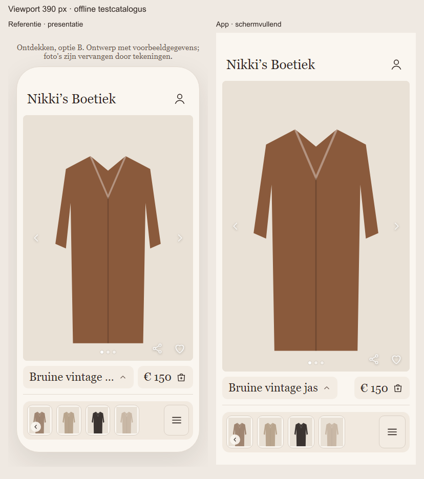
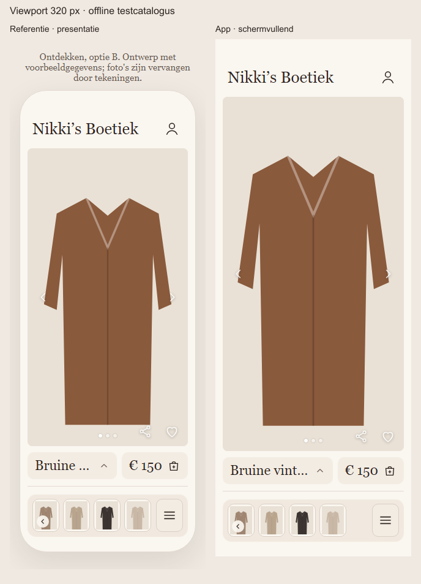

# Optie B — visuele vergelijking

Bijgewerkt op 10 november 2026 met Chromium na de review van PR #19. Links staat de ongewijzigde `concept/ontdekken-optie-b.html`, rechts de gebouwde cloudpilot uit `app/`. Viewports: 390 × 844 en 320 × 844 px. Dit zijn volledige pagina's naast elkaar, zonder schaling of retouche.

Met Martijns akkoord vervalt in de app het telefoonkader: geen rand, schaduw, ronde buitenhoeken, buitenmarge of succesregel. Tot en met 480 px vult het scherm de viewport, daarboven blijft het gecentreerd op 390 px. De foto krijgt de extra beschikbare ruimte; de bestaande binnenmaten, volgorde, kleuren, letters en bediening blijven leidend.

De cloudpilot leest in deze test synthetische publieke records via de nagebootste bestaande catalogus-API en beveiligde foto-route. De tekeningen, namen en prijzen zijn testgegevens, geen echte inventaris. Geen privéfoto's, fototokens of klantgegevens vastgelegd. Externe fonts zijn in de test geblokkeerd, dus beide kanten gebruiken de bestaande Georgia-terugval; in de app blijft dezelfde Newsreader-link als in de referentie staan.

Losse volledige pagina's; de ontwerpnotitie staat alleen boven de referentie. De app-status is na succesvol laden verborgen:

| Viewport | Referentie | Cloudpilot |
|---|---|---|
| 390 px | [Volledige referentie](reference-390.png) | [Volledige app](app-390.png) |
| 320 px | [Volledige referentie](reference-320.png) | [Volledige app](app-320.png) |

Herhalen: `npm run build && npm run test:browser`. De losse PNG's komen in `work/option-b-screenshots/` (instelbaar met `NIKKI_SCREENSHOTS`). Voor de geometrische vergelijking normaliseert de test uitsluitend het buitenvlak van de referentie naar de beschikbare app-breedte en -hoogte; de binnen-HTML/CSS blijven intact. Afmetingen, posities en berekende stijlen van die binnenindeling moeten gelijk zijn. Het schermvullende formaat wordt apart gecontroleerd.

De test bewaakt foto / naam-prijs / onderrij, minimaal 44 px, geen overlap of tekst over foto's, en dezelfde knopverhouding. De containerregels rekenen nu in de app met meer ruimte: op 390 px zijn de onderste knoppen 52 px breed met 8 px tussenruimte; op 320 px zijn ze 44 px breed met 6 px tussenruimte. Op 280 px blijven twee volgende stukken over. Viewports 283/284 en 331/332 controleren beide kanten van de onderrij-breekpunten; 480/481 en 1024 controleren schermvullend versus desktop.

Regressies: mand blijft intact als gepubliceerde foto's tijdelijk ontbreken of de catalogusaanvraag faalt, en wordt wel opgeschoond bij verkoop/terugtrekking. Een lege collectie verbergt het SVG-vinkje. Een verdwenen vorig stuk valt terug op een ander stuk; bij één stuk wordt die knop uitgeschakeld. Materiaal en bontsoort zijn veilige tekst; ontbrekende velden worden weggelaten en bij `furClass=Nee` wordt geen bontsoort getoond. Winkelmand vermeldt dat afrekenen nog niet kan. Laden, fout en herstel verschuiven de indeling niet.

De cloudtest bewaakt daarnaast invoer, opslag, beveiligde fotolinks, behoud van het open venster en de gekozen foto bij vernieuwing, en verkocht-status. Deze checks gebruiken nagebootste diensten; live Supabase Auth/Storage en Gemini zijn voor deze wijziging niet opnieuw getest. Veilige randen zijn met CSS-insets gesimuleerd; fysiek iOS/Safari en dynamische browserbalken zijn niet getest. Geen migratie of handmatige deployment uitgevoerd; de bestaande Cloudflare-koppeling bouwt automatisch een branchpreview.

De zelfstandige `tests/ontdekken-optie-b.cjs` slaagt. Bij de eerdere controle op 9 november stopten `tests/prototypes.cjs` en `tests/connected-demo.cjs` lokaal bij de HTML-export met `download.path: canceled`. De betrokken prototypes/tests zijn ongewijzigd en niet opnieuw uitgevoerd in deze reviewronde; deze exportcontroles vallen buiten `npm run test:browser`.
