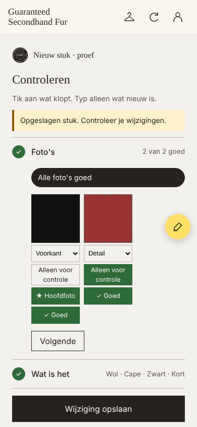
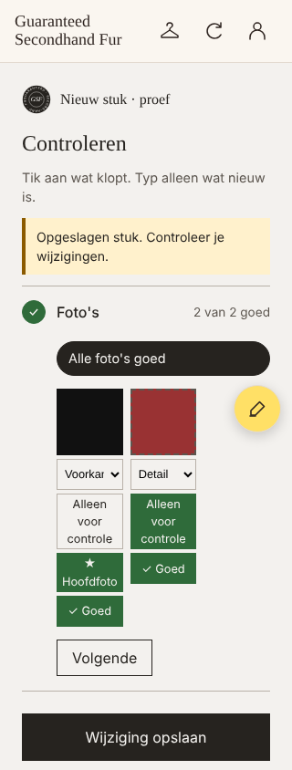
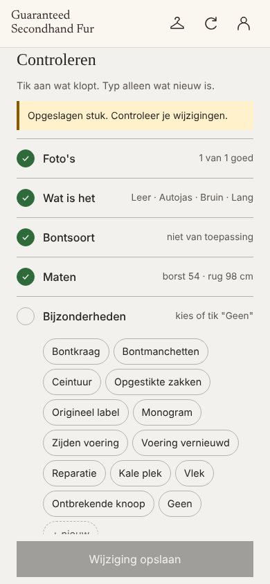

# Foto's alleen voor controle — schermafbeeldingen

Gemaakt door `tests/cloud-browser.cjs` (nagebootste Supabase), 15 november 2026. Een bewerkt stuk met twee foto's: links de hoofdfoto voor de boetiek, rechts een foto die alleen voor controle is (gestippelde rand, knop aan, geen hoofdfotoknop). Het invoerscherm heeft nog het oude uiterlijk; dat wordt vernieuwd in de fase "invoer als eigen bron" (docs/BEHEER-PLAN.md).

| 390 px | 320 px |
| --- | --- |
|  |  |

## Opslaan met een open onderdeel

Een tik op de grijze opslagknop opent het onderdeel dat nog niet af is (390 px).
