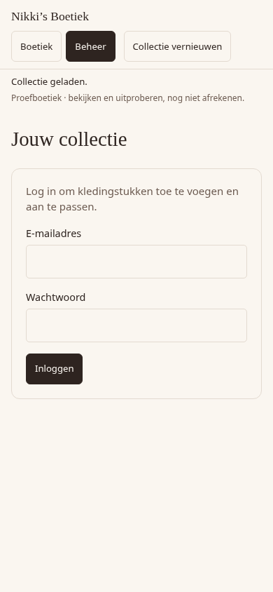
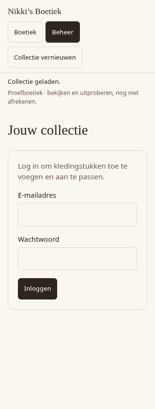

# Beheer fase 0: opsplitsing zonder zichtbare verandering

Basis: opnieuw opgehaalde `origin/main` op `516df19` (13 november 2026). Branch: `codex/beheer-fase-0-modules`. De bestaande fase-0-commit `ef04e2b` is behouden; `git merge origin/main` meldt dat de branch al bij is. Geen rebase of force-push.

## Nieuwe vergelijking op 13 november

Chromium 154.0.8037.57, Node.js 24.19.0, 390 × 844 en 320 × 844. Beide builds gebruiken dezelfde synthetische collectie en nagebootste diensten. Geen productiegegevens. De muis staat buiten de bediening. Vijf van de zes vergelijkingen zijn pixelgelijk (RGB). Alleen collectie op 320 px heeft 70 afwijkende randpixels, met maximaal 2/255 verschil per kleurkanaal; geen zichtbare indelings- of tekstwijziging.

**Lettertypebeperking:** externe fonts worden door de fixture geblokkeerd. Deze schermafbeeldingen tonen een terugvalletter, geen echte Newsreader. Fase 0 verandert de typografie niet. Voor PR #36 moet de letter in de test beschikbaar worden gemaakt, of de beperking opnieuw expliciet in de PR worden vermeld.

| Scherm | Voor 390 | Na 390 | Voor 320 | Na 320 |
|---|---|---|---|---|
| Inloggen | [Voor](before/login-390.png) | [Na](after/login-390.png) | [Voor](before/login-320.png) | [Na](after/login-320.png) |
| Collectie | [Voor](before/collection-390.png) | [Na](after/collection-390.png) | [Voor](before/collection-320.png) | [Na](after/collection-320.png) |
| Boetiek | [Voor](before/shop-390.png) | [Na](after/shop-390.png) | [Voor](before/shop-320.png) | [Na](after/shop-320.png) |

### Inloggen, 390 px

| Nieuwste main | Fase 0 |
|---|---|
|  |  |

### Inloggen, 320 px

| Nieuwste main | Fase 0 |
|---|---|
|  |  |

**Ontwerpvergelijking nog open:** het [gedeelde Claude Design-artefact](https://claude.ai/artifact/QJQ9iW4aZkmPKtiqW7nmE6) kon in deze omgeving niet worden geopend: de netwerkproxy weigert de verbinding met HTTP 403. Er is daarom geen ontwerpafbeelding naast de bovenstaande beelden geplaatst en geen visuele overeenkomst met het artefact geclaimd. Het nieuwe inlogontwerp (witte kaart op `#9B3A2F`) hoort bij PR #36, na de merge van fase 0 door Martijn.

## Controles en overdracht

- `npm run build`: geslaagd.
- `npm test`: 51/51 geslaagd.
- `npm run test:browser`: cloud-UI en volledige storefront-layoutcontrole geslaagd; de suite faalde daarna op de bestaande klembordrace in `tests/storefront-share.cjs:65` (lege klembordinhoud vóór de asynchrone kopieerbevestiging). Een afzonderlijke herhaling van de ongewijzigde deelt-test slaagde. Dit timingprobleem is niet opgelost en de volledige run wordt niet als groen gerapporteerd.
- `npm run check` en `git diff --check`: geslaagd.
- Extra browsercontrole op beide breedtes: zonder configuratie zijn de inlog-submit en vernieuwknop uitgeschakeld, zonder JavaScript-fout. De knop heeft nu expliciet `type="submit"`, zodat de specifiekere selector ook vóór PR #36 werkt.
- `function show` staat vóór `createAdmin`. `app/main.js` houdt opstarten, schermwissel en het bestaande `window.NikkiApp`-contract. `app/admin/index.js` houdt gedeelde toestand en actievergrendeling; `header.js` bediening en kleurkoppeling; `login.js` sessie en inloggen; `collection.js` fotolinks, lijst, bewerken, verkocht en vernieuwing.
- Geen API-, opslag-, rechten-, AI-, intake- of boetiekwijzigingen. Live Supabase/Gemini en fysieke telefoons niet getest.
- Martijn beslist over merge. Pas daarna PR #36 op deze basis zetten met een merge, één set tokens/header/login behouden, alle reviewpunten verwerken en `BEHEER-PR-REEKS.md` aanvullen met snel bewerken, verkocht met vijf seconden ongedaan maken en concepten bewaren. Daarna opnieuw Claude Code-review; geen merge of release door Codex.
