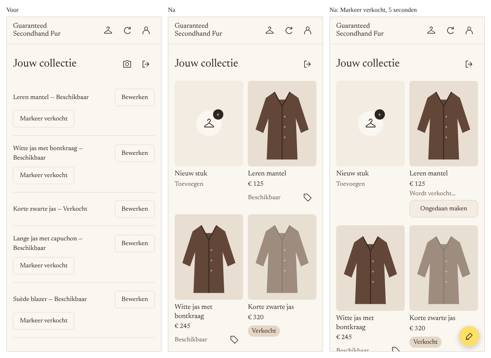
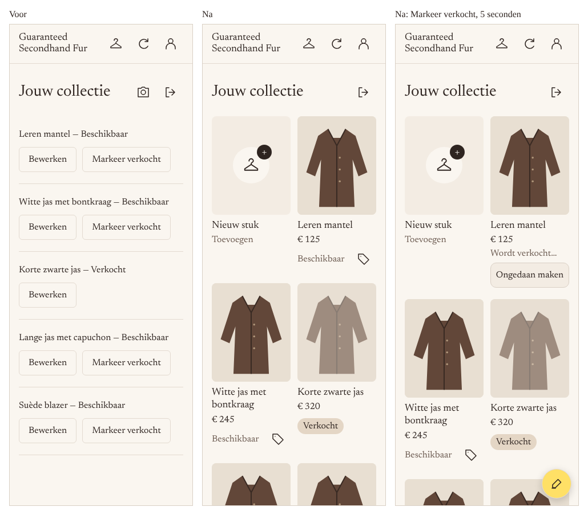

# Jouw collectie als fotoraster (15 november 2026)

Gemaakt met Chromium op 390 × 844 en 320 × 844 px, met testgegevens (een getekende jas, geen echte voorraad). "Voor" is `main` (`07ea0ae`). Het gele potloodje rechtsonder is de tijdelijke opmerkingenknop; die hoort niet bij dit ontwerp.

- Twee kolommen. Linksboven de +-kaart met het kleerhangericoon; die opent Nieuw stuk.
- Per kaart: hoofdfoto, titel, prijs en status, onder de foto. Tik op de kaart om te bewerken.
- Het labeltje (44 px) is "Markeer verkocht". Daarna staat er vijf seconden "Ongedaan maken"; pas daarna wordt het opgeslagen. Een verkocht stuk heeft geen knop meer.
