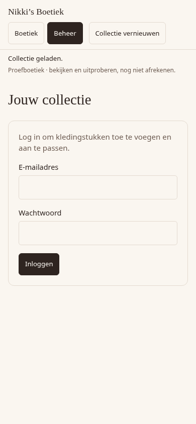
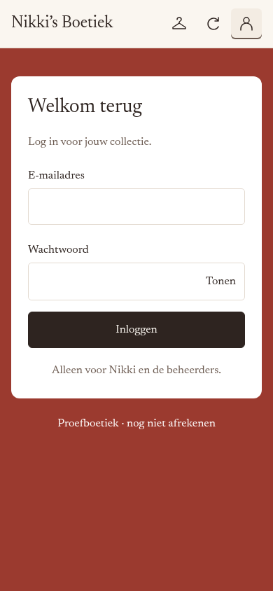
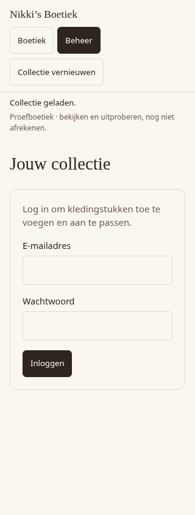
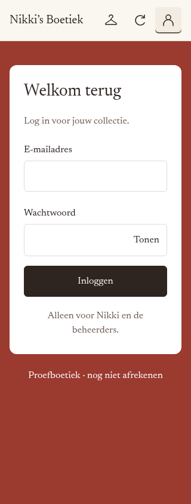
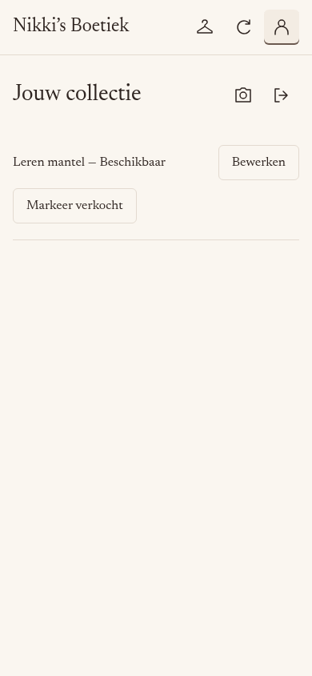
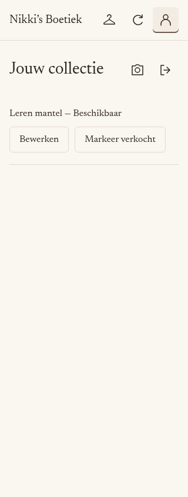

# PR #36: bovenbalk en inloggen

390 × 844 en 320 × 844, Chromium, synthetische collectie. De nieuwe beelden tonen **echte Newsreader**: de test wacht op de lokale fontfixture en controleert de werkelijk gerenderde letter via Chromium. Productie blijft Google Fonts laden.

| Breedte | Fase 0 vóór deze PR (fallbackletter) | Na deze PR (Newsreader) |
|---|---|---|
| 390 px |  |  |
| 320 px |  |  |

| Collectie 390 px | Collectie 320 px |
|---|---|
|  |  |

De bovenbalk heeft één rij met merknaam en drie iconen (boetiek, vernieuwen, account), met een subtiele actieve markering. Nieuw stuk en uitloggen blijven als 44px-iconen naast de collectietitel bereikbaar. Het raster en de camerategel volgen in de volgende PR.

De inlogkaart is wit op `#9B3A2F`; ‘Proefboetiek · nog niet afrekenen’ staat eronder. Er staat geen statusregel boven het inlogscherm. Loginproblemen worden in het formulier gemeld; fouten ná authenticatie staan bij de collectie.

**Ontwerpbeperking:** het [gedeelde Claude Design-artefact](https://claude.ai/artifact/QJQ9iW4aZkmPKtiqW7nmE6) is in deze omgeving door de netwerkproxy geblokkeerd (HTTP 403). De beschreven ontwerpbesluiten uit Martijns opdracht en beide Claude Code-reviews zijn verwerkt. Een rechtstreeks bekeken ontwerpafbeelding naast deze screenshots en een pixelvergelijking met Claude Design ontbreken; die overeenkomst wordt niet geclaimd.

De mobiele tests dekken breedte, één rij, letter, 16px-tekst, 44px-iconen, focus en de positie/kleuren van kaart en proefmelding. Daarnaast: in-/uitloggen, verkeerd wachtwoord, geen beheerrechten, vernieuwingsfout na login, herstellen, dubbele submit en vernieuwing tijdens login. Live Supabase/Gemini en een fysieke telefooncamera niet getest.
