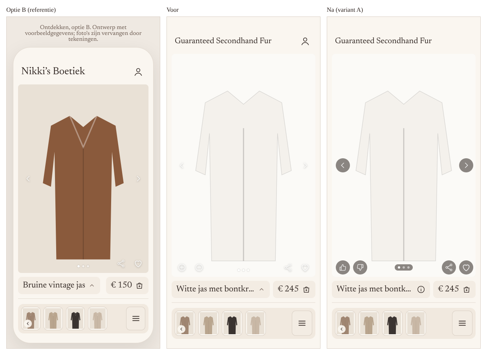
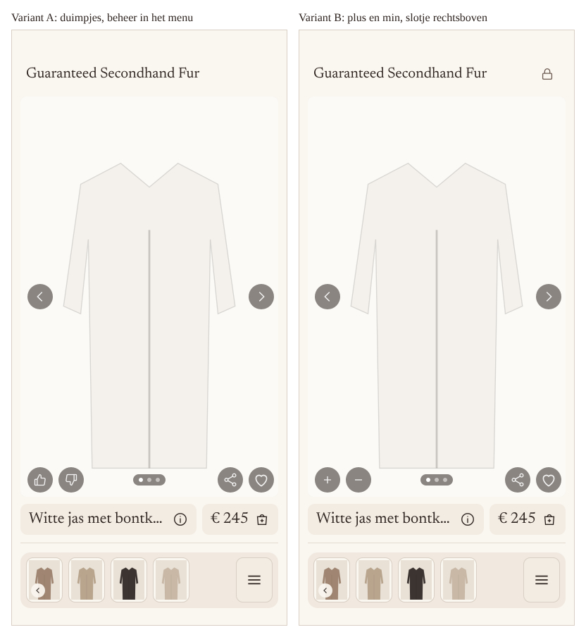

# Boetiek: vijf aanpassingen (15 november 2026)

Gemaakt met Chromium op 390 × 844 en 320 × 844 px, met testgegevens (getekende jassen, geen echte voorraad). "Voor" is `main` (`07ea0ae`); "Na" is deze wijziging. De witte jas laat zien waarom de iconen een achtergrond nodig hebben.

| Onderdeel | 390 px | 320 px |
|---|---|---|
| Boetiek naast optie B: i-icoon, ronde achtergronden, duimpjes | [boetiek-390.png](boetiek-390.png) | [boetiek-320.png](boetiek-320.png) |
| Keuze voor Martijn: variant A naast variant B | [varianten-390.png](varianten-390.png) | [varianten-320.png](varianten-320.png) |
| Informatievenster | [info-390.png](info-390.png) | [info-320.png](info-320.png) |
| Menu met de regel Beheer | [menu-390.png](menu-390.png) | [menu-320.png](menu-320.png) |
| Collectie: sorteerkeuze "Onze volgorde" | [collectie-390.png](collectie-390.png) | [collectie-320.png](collectie-320.png) |
| Mijn smaak: leesbare labels | [smaak-390.png](smaak-390.png) | [smaak-320.png](smaak-320.png) |

## Keuze voor Martijn

- **Variant A (gebouwd):** duim omhoog/omlaag voor meer/minder zoals dit; het poppetje rechtsboven is weg en "Beheer" staat als laatste, rustige regel in het menu.
- **Variant B (alleen als schermafbeelding):** plus en min in de ronde achtergrond; de ingang voor beheer blijft rechtsboven als klein slotje in de zachte kleur.

De twee keuzes staan los van elkaar: duimpjes kunnen ook met het slotje, en plus/min met de menuregel.

