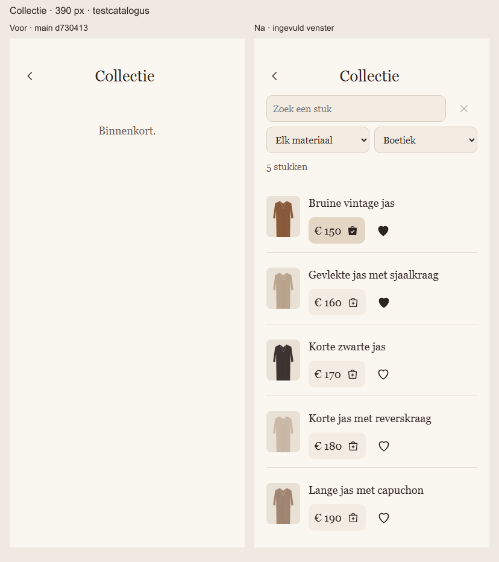
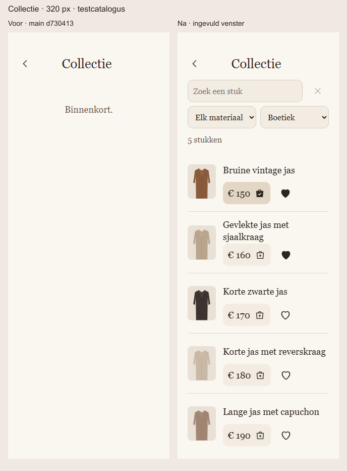
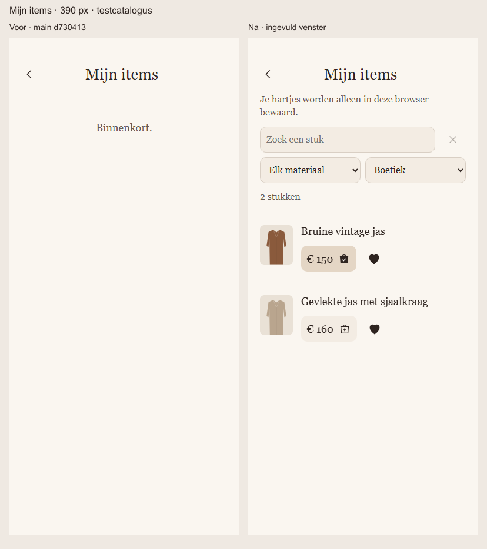
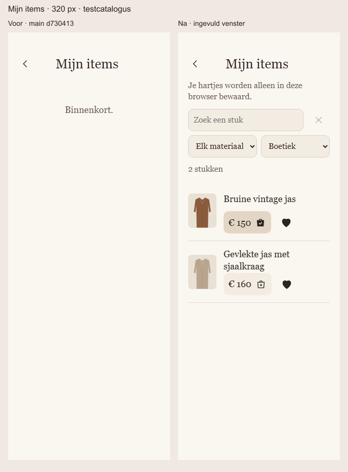

# Collectie en Mijn items — voor en na

Vastgelegd op 10 november 2026 in Chromium, bij viewports van 390 × 844 en 320 × 844 px. Links staat de opgehaalde, goedgekeurde main d730413; rechts dezelfde winkel met de ingevulde vensters. Volledige pagina's zonder schaling of retouche. De hoofdwinkel en ontwerpreferentie zijn niet vervangen.

De records en tekeningen komen uit de bestaande publieke catalogus-testinterface. Hartjes zijn lokale testkeuzes; geen echte inventaris, privéfoto's, klantgegevens of fototokens in beeld. Externe fonts zijn geblokkeerd, waardoor beide kanten de bestaande Georgia-terugval gebruiken.

## Collectie

## Mijn items

| Nieuw venster | 390 px | 320 px |
|---|---|---|
| Collectie | [Volledig beeld](collection-390.png) | [Volledig beeld](collection-320.png) |
| Mijn items | [Volledig beeld](saved-390.png) | [Volledig beeld](saved-320.png) |

Herhalen: `npm run build && npm run test:browser`. De browsertest schrijft de nieuwe losse beelden naar `work/option-b-screenshots/` (of `NIKKI_SCREENSHOTS`). De voor-beelden zijn gemaakt vóór de implementatie op de geverifieerde main. De vergelijkingen combineren alleen die twee beelden met een kopregel.

De browsertest controleert zoeken/filteren/sorteren, lokale hartjes en mand, terugkeer uit details met behoud van scroll en focus, actuele fotolinks en beschikbaarheid, lege lijsten, knoppen van minstens 44 px, tekst naast foto's en werking op 568 px hoge schermen. Zie [functieoverzicht en testgrenzen](../../FUNCTIONALITEIT.md). De bestaande referentievergelijking en cloudtests blijven actief.
