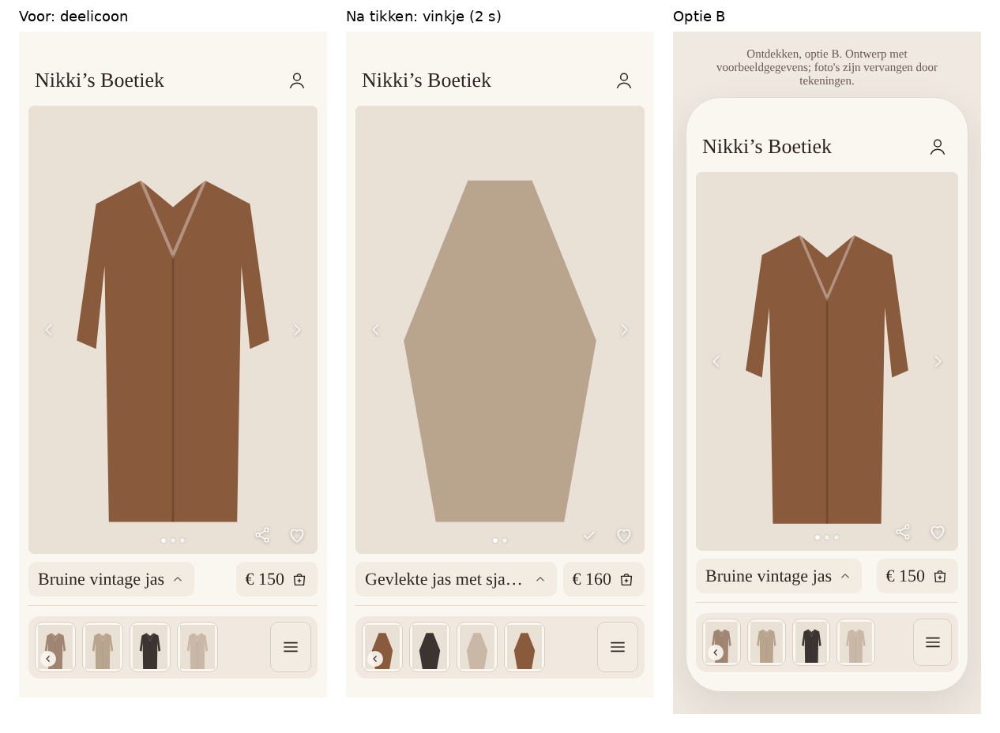
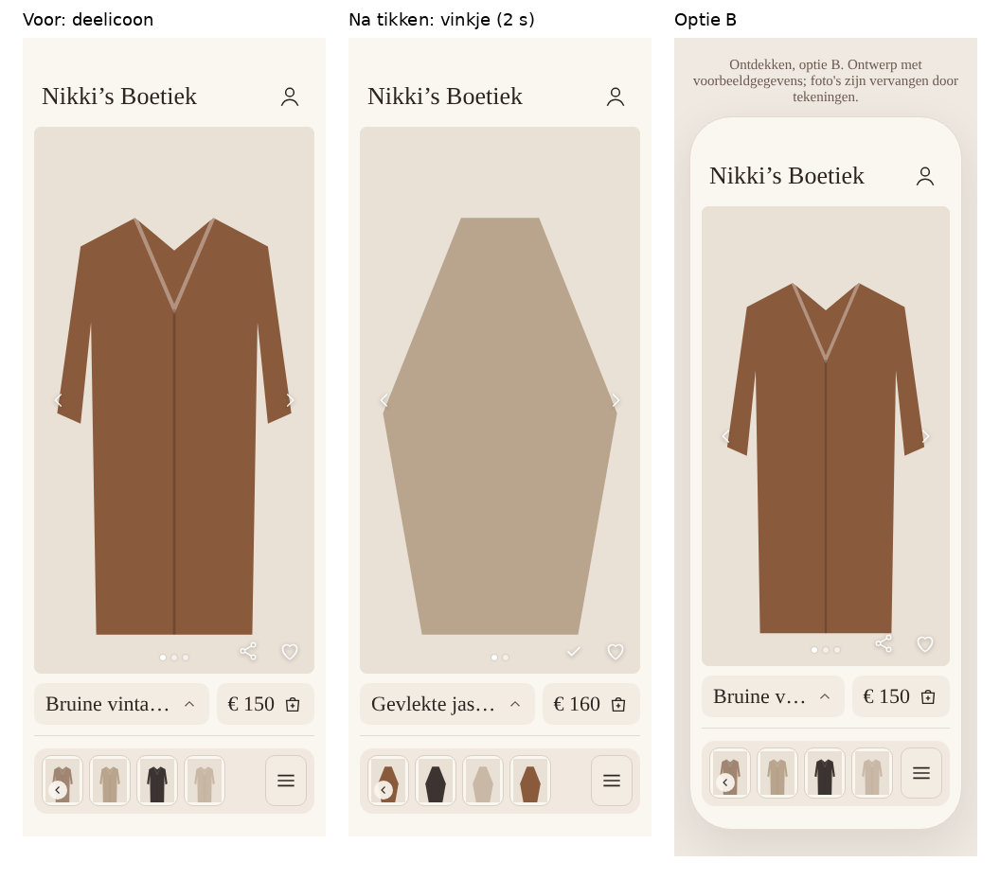

# Delen — voor, na en optie B

Vastgelegd op 11 november 2026 in Chromium, bij 390 × 844 en 320 × 844 px, met testrecords en tekeningen. Links staat de winkel met het deelicoon (ongewijzigd ten opzichte van `main`). In het midden staat hetzelfde icoon twee seconden na het kopiëren van de link, als vinkje; daarna komt het deelicoon terug. Rechts staat de referentie `concept/ontdekken-optie-b.html`. De indeling, plaats en maat van de knop (44 px) zijn ongewijzigd. Er komt geen tekst over de foto.

Op een telefoon met deelmenu opent één tik dat menu, met alleen de titel en de link. Het vinkje verschijnt alleen als de link wordt gekopieerd.

Opnieuw maken: `npm run build && npm run test:browser`. `tests/storefront-share.cjs` schrijft `share-copied-<breedte>.png` naar `work/option-b-screenshots/`.
