# Feedback 19 november: vóór en na

Gemaakt op 22 november 2026 in Chromium, met de testfixture (testgegevens, geen echte voorraad of privéfoto's). Viewports 390 × 693 (de hoogte van Nikki's telefoon) en 320 × 568. **Vóór** = `main` (`867abb8`), **na** = branch `claude/feedback-19-november`. Opnieuw maken: `npm run build`, daarna `node scripts/screenshots-feedback-19-november.cjs <map>`.

De gele potloodknop rechtsonder is de testmodus voor feedback. Die staat alleen aan voor beheerders tijdens de proef.

| Scherm | Vóór 390 | Na 390 | Vóór 320 | Na 320 |
|---|---|---|---|---|
| Leeg (fotokiezer) | 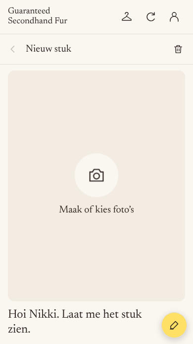 | 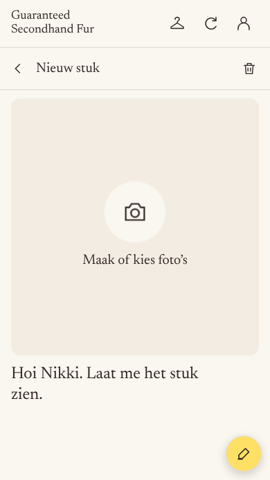 | 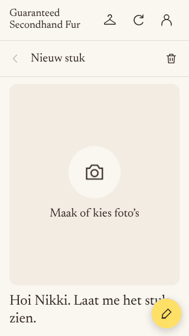 | 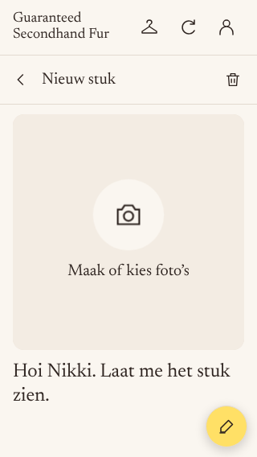 |
| Twee foto's | 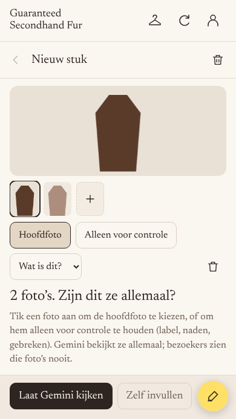 | 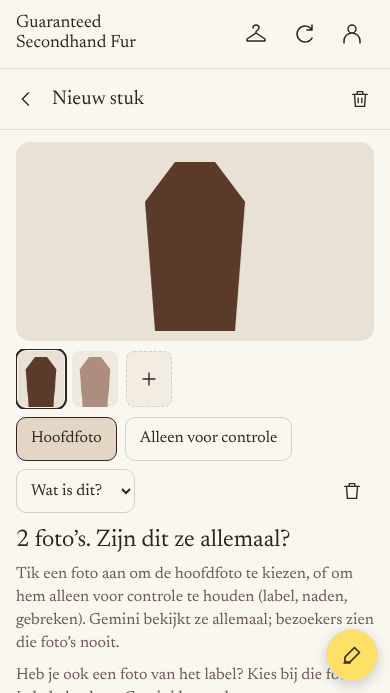 | 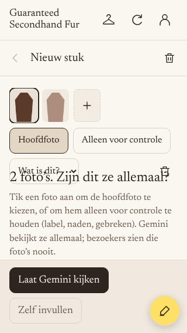 | 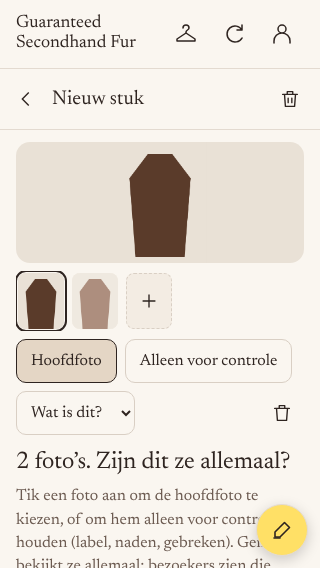 |
| Een vraag | 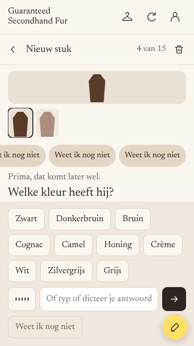 | 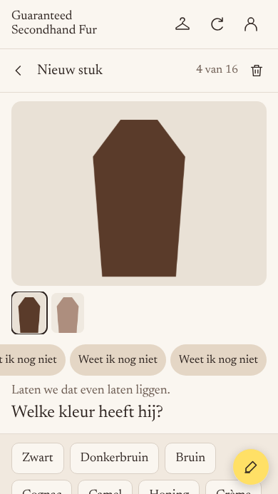 | 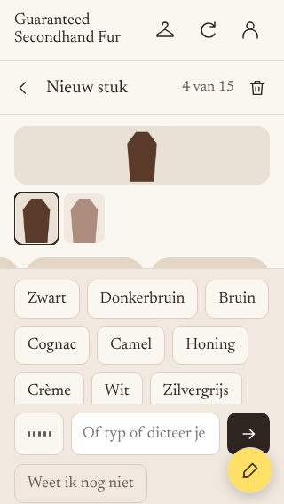 | 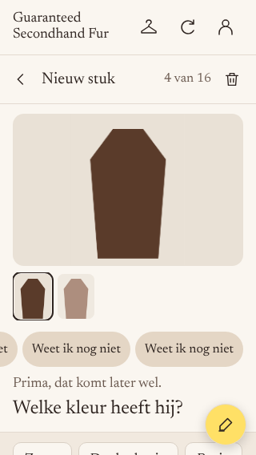 |
| Jouw collectie na terug | 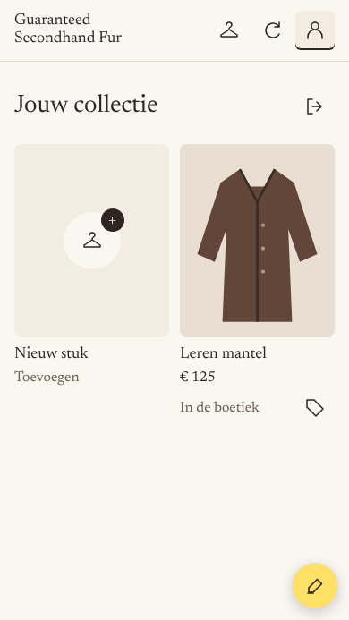 | 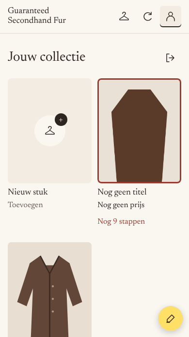 | 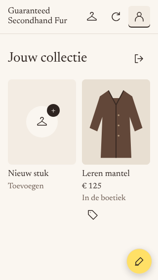 | 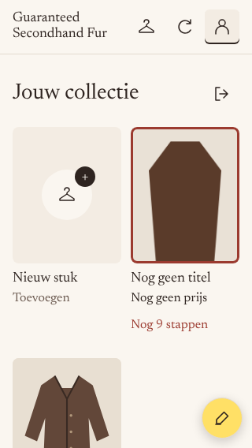 |
| Bewerken (overzicht) | 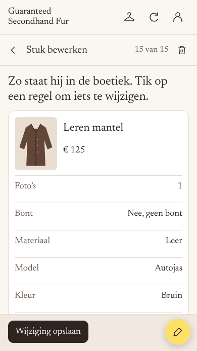 | 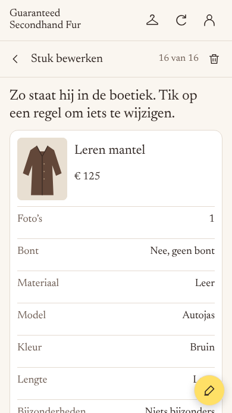 | 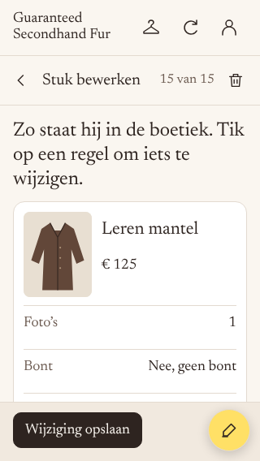 | 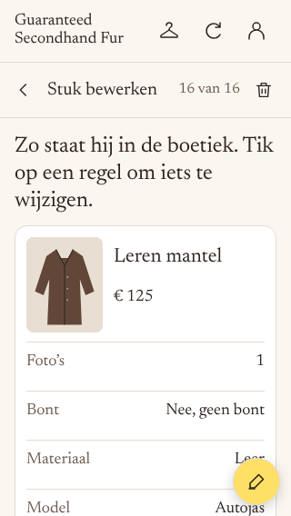 |
| Schermvullend (nieuw) | – | 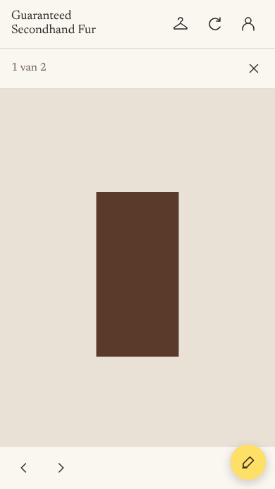 | – | 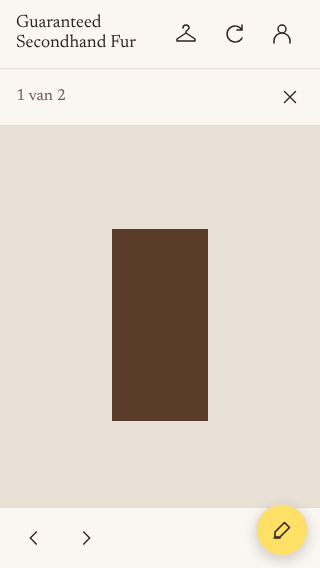 |

Wat je ziet:
- **Twee foto's:** op 320 px was de foto vóór de wijziging weg en lagen de fotoknoppen over de tekst. Nu blijft de foto zichtbaar en staan de knoppen erboven. Onder de foto's vraagt het scherm om een labelfoto, en er is een notitieveld voor Gemini (onderaan, scrollen).
- **Een vraag:** de foto is veel groter. Vraag en antwoorden scrollen samen eronder.
- **Jouw collectie:** het onaffe stuk staat vooraan met een rode rand; onder de foto staat hoeveel stappen nog nodig zijn. Vóór de wijziging was het onzichtbaar, en Bewerken wiste het.
- **Bewerken:** het pijltje gaat nu terug naar Jouw collectie in plaats van naar de laatste vraag.
- **Fotokiezer:** het verschil zit in de telefoon (Android toont de galerij in plaats van een bestandsbeheerder). Dat is op een schermafbeelding in Chromium niet te zien.

Niet getoond: dezelfde schermen naast `concept/ontdekken-optie-b.html`. Optie B beschrijft de winkel, niet Nieuw stuk. Deze PR verandert de winkel niet.
