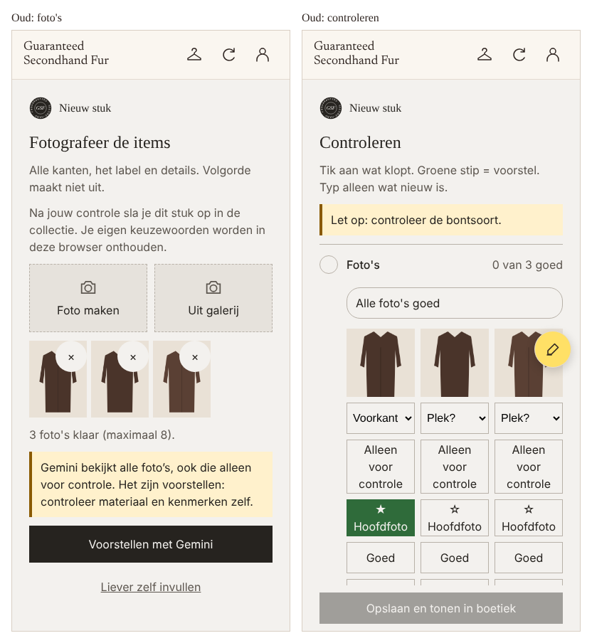
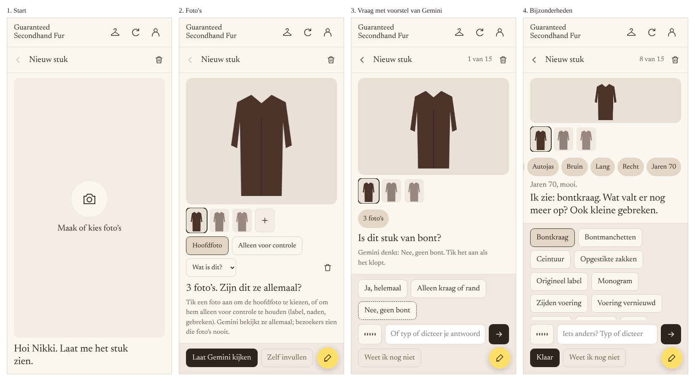
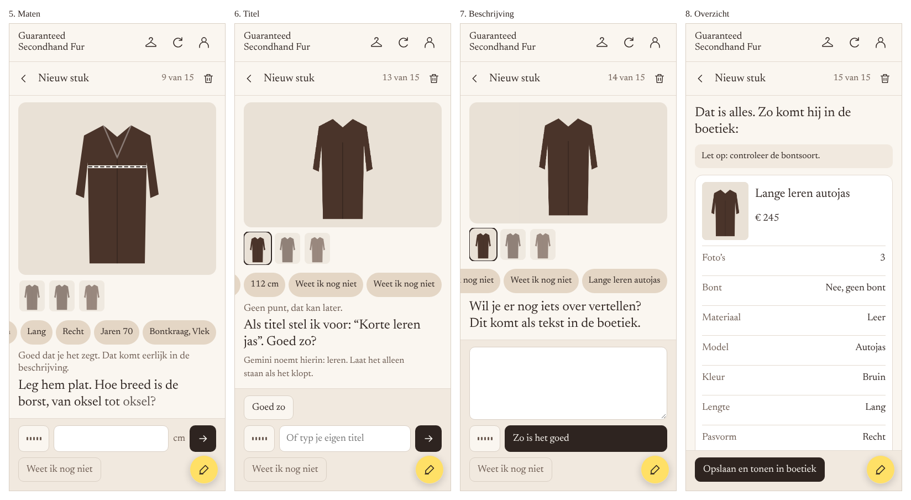
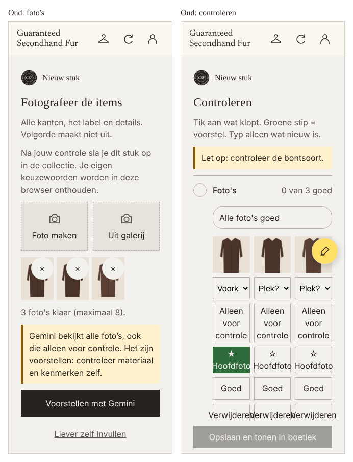
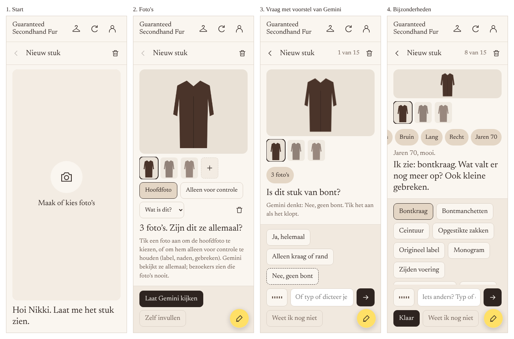
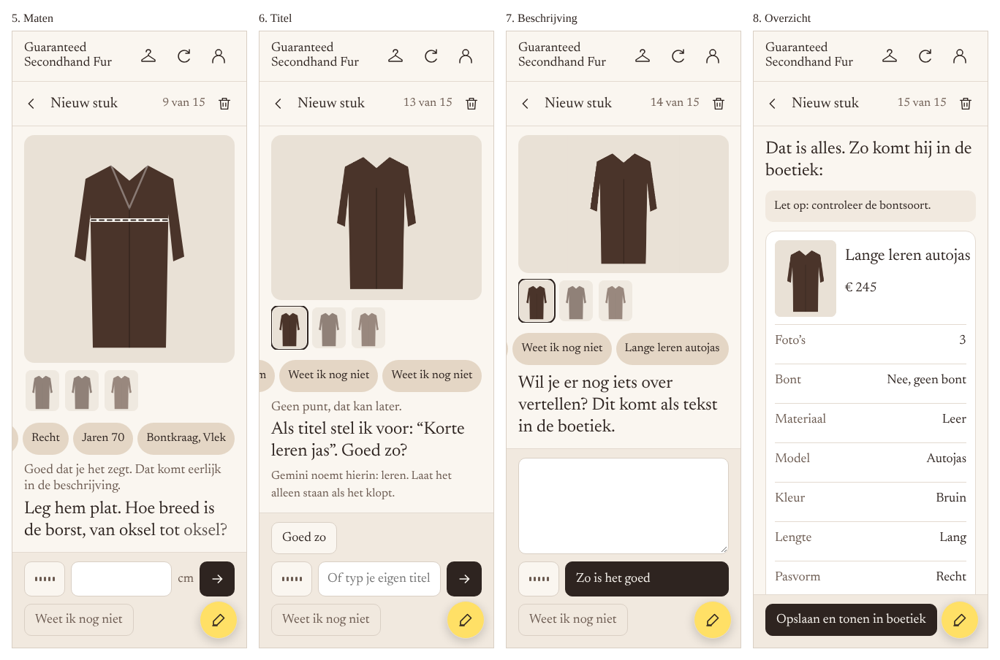
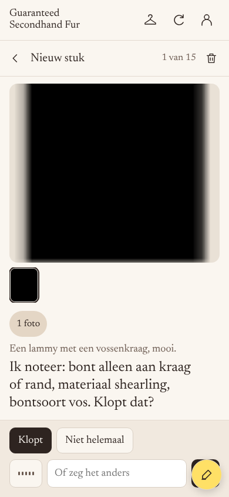
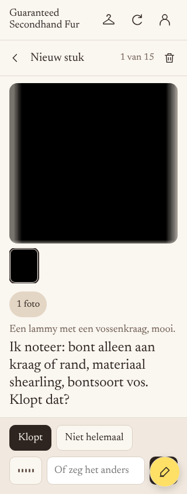
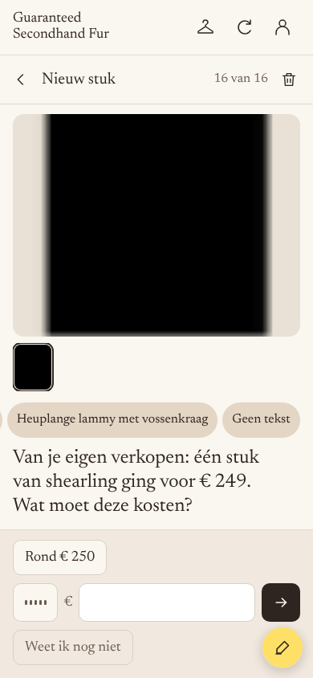
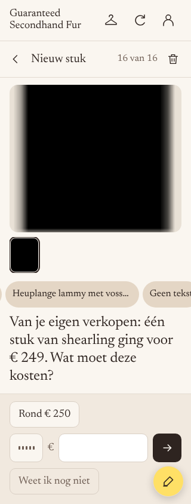

# Nieuw stuk als gesprek in de app (15 november 2026)

Chromium op 390 × 844 en 320 × 844 px, in de echte app met nagebootste diensten en getekende jassen. "Oud" is het invoerscherm van `main` (`07ea0ae`). Het gele potloodje is de tijdelijke opmerkingenknop; op de nieuwe schermen staat hij sinds deze wijziging rechtsonder.

## 390 px

## 320 px

Beweging (woord voor woord, de lichtbaan, de golfjes) is op een stilstaand beeld niet te zien.

## Natuurlijker gesprek (vervolg op PR #58)
Een vrije zin die Gemini begreep, met eerst "Klopt dat?", en het prijsvoorstel uit eigen verkopen (een knop, niet vooraf gekozen).

