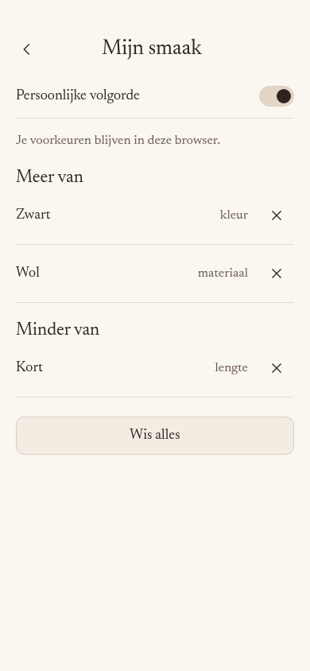
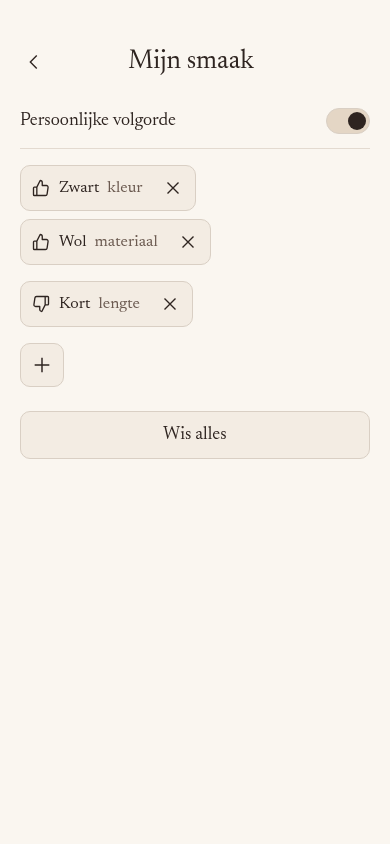
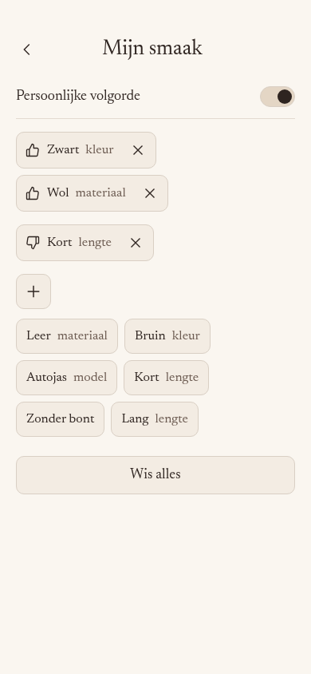
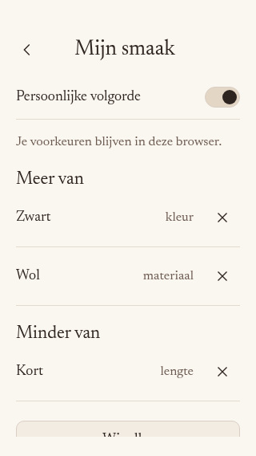
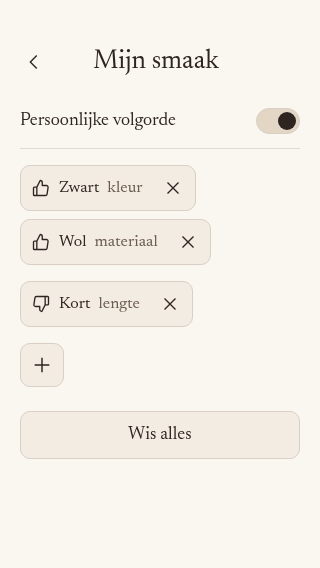
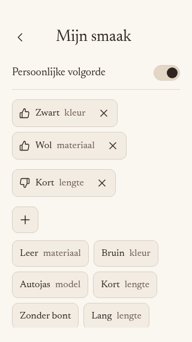
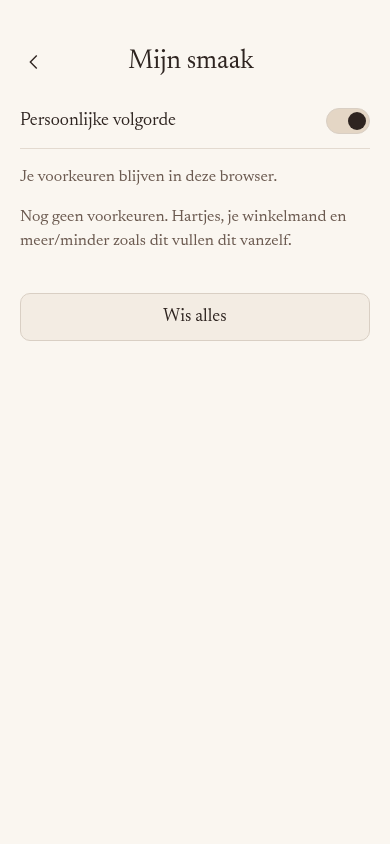
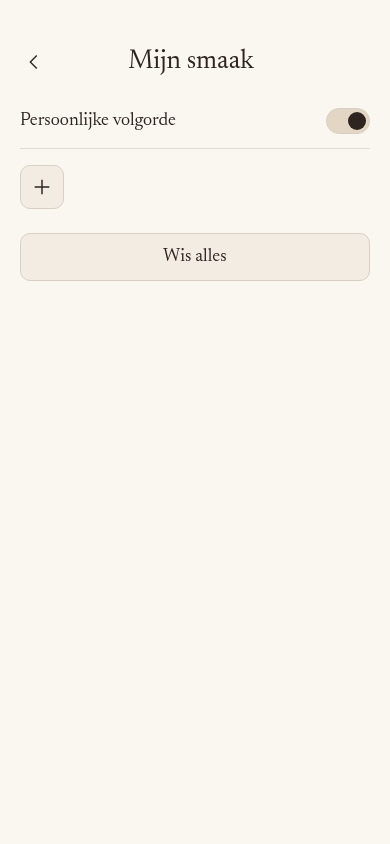
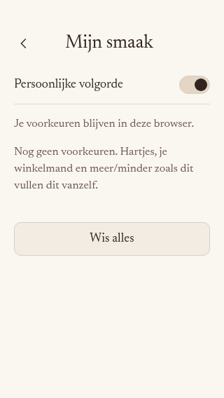
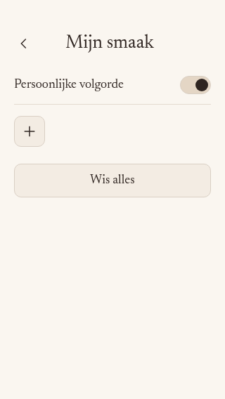

# Mijn smaak — issue #72

Voor/na op `aa52447` en `codex/issue-72-taste-chips`. De echte gebouwde winkel, Newsreader en gewone synthetische catalogusgegevens; alle netwerkdiensten nagebootst. Geen echte producten of live Gemini-aanroepen.

| Scherm | Vóór | Na | Toevoegen |
| --- | --- | --- | --- |
| 390 × 844 |  |  |  |
| 320 × 568 |  |  |  |

| Leeg | Vóór | Na |
| --- | --- | --- |
| 390 × 844 |  |  |
| 320 × 568 |  |  |

Alleen het venster Mijn smaak verandert. De uitleg en de losse Meer/Minder-koppen zijn weg. Duimiconen houden de richtingen herkenbaar; bestaande leesbare kenmerklabels blijven. Schakelaar, wisbevestiging en opslagfoutmelding blijven behouden.

De plusknop biedt maximaal twaalf deterministisch gekozen kenmerken uit de bestaande publieke catalogus, verdeeld over de ondersteunde dimensies materiaal, kleur, model, lengte en bontklasse. Al positieve voorkeuren verdwijnen uit die vaste set; de set schuift hierdoor niet op naar steeds nieuwe kenmerken. Een keuze gebruikt het bestaande expliciete filter en de bestaande compacte personalisatieroute. Er zijn geen nieuwe velden, diensten of vrije invoer.

**Contractgrens:** het huidige profiel en `readable()` ondersteunen bontklasse (met/zonder bont), geen afzonderlijke bontsoort. Die wordt hier niet als een ander kenmerk vermomd en het profiel/servercontract is niet uitgebreid. Martijn verduidelijkte dat zijn wens voor onzekere bontsoortvoorstellen over fotoanalyse bij Nieuw stuk gaat; die route bestaat al op main en is buiten deze wijziging gebleven.

De veiligheidsfixture in `tests/storefront-taste.cjs` gebruikt ook opzettelijke HTML-achtige labels om tekstescaping te controleren. Die testtekst staat niet in deze ontwerpbeelden. De suite bewaakt onder meer verwijderen, toevoegen, weigeren van vervalste keuzes, een grote catalogus, opslagfouten, lege staat, geen vrije invoer, 44 px/16 px, focus en behoud van het bestaande smaakgedrag.
