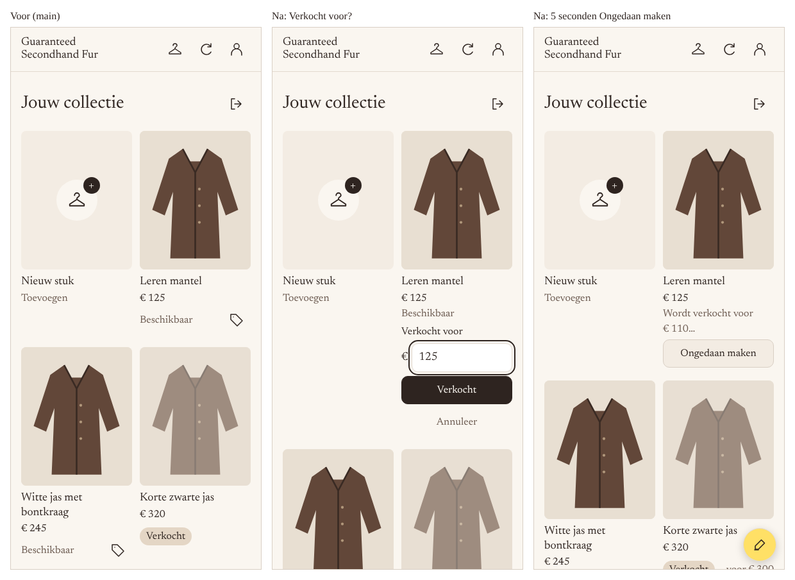
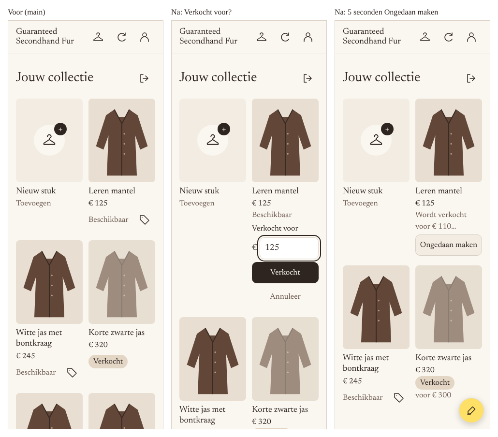

# Verkoopprijs bijhouden (15 november 2026)

Chromium op 390 × 844 en 320 × 844 px, met testgegevens. Het gele potloodje is de tijdelijke opmerkingenknop.

- Tik op het labeltje: de vraag "Verkocht voor" verschijnt in de kaart, met de vraagprijs al ingevuld.
- Na "Verkocht" staat er vijf seconden "Ongedaan maken"; pas daarna wordt het opgeslagen.
- Een verkocht stuk toont daarna voor welk bedrag het wegging. Alleen beheerders zien dat.
