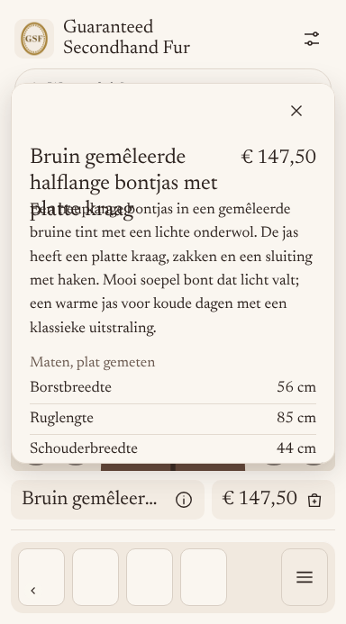
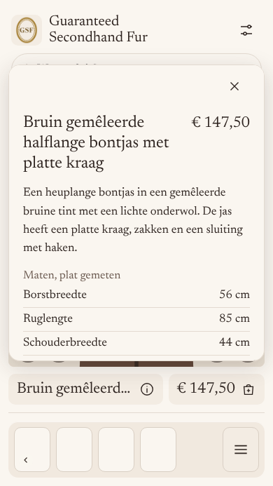
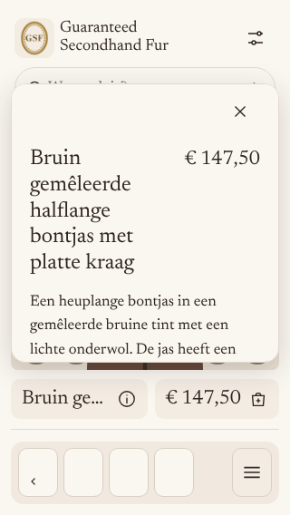
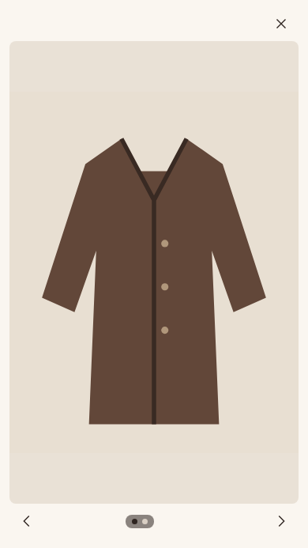
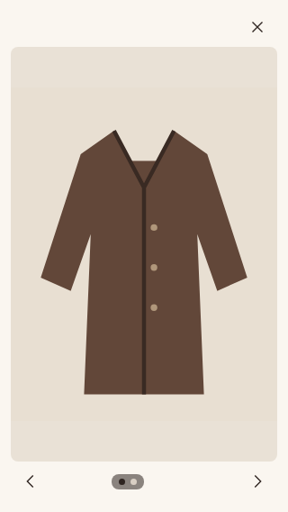
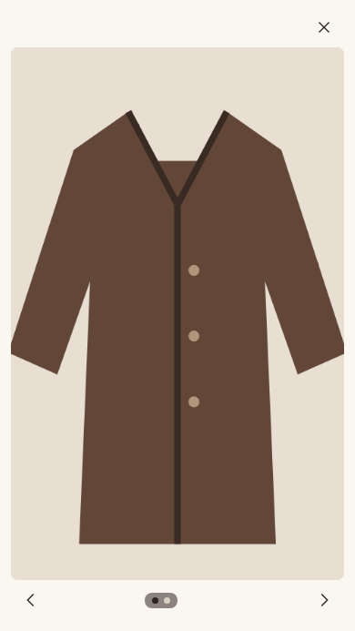
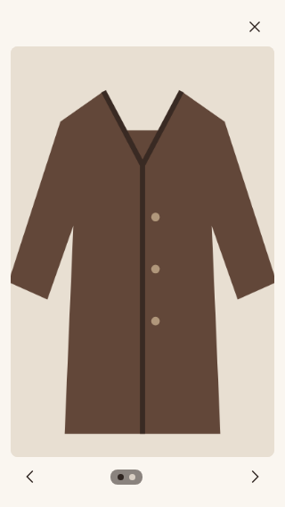

# Winkel: titel in het informatievenster en foto schermvullend (25 november 2026)

Gemaakt in Chromium met de testfixture (testgegevens, een getekende jas). Aanleiding: Nikki's opmerkingen 33 en 36 van 24 november; besluit van Martijn op 25 november ("maak dit mooi", "doe maar").

| | 390 × 693 | 320 × 568 |
|---|---|---|
| Vóór: titel over de tekst (384 px) |  | |
| Na: informatievenster |  |  |
| Na: één tik op de foto |  |  |
| Na: dubbel tikken of knijpen om in te zoomen |  |  |

De vergelijking met `concept/ontdekken-optie-b.html` staat in de bestaande test `tests/storefront-layout.cjs`; de foto, naam, prijs en navigatie zijn ongewijzigd. Het schermvullende venster is nieuw: alleen de foto, sluiten boven en de pijlen en stipjes onder, nooit tekst op de foto, knoppen van 44 px.
