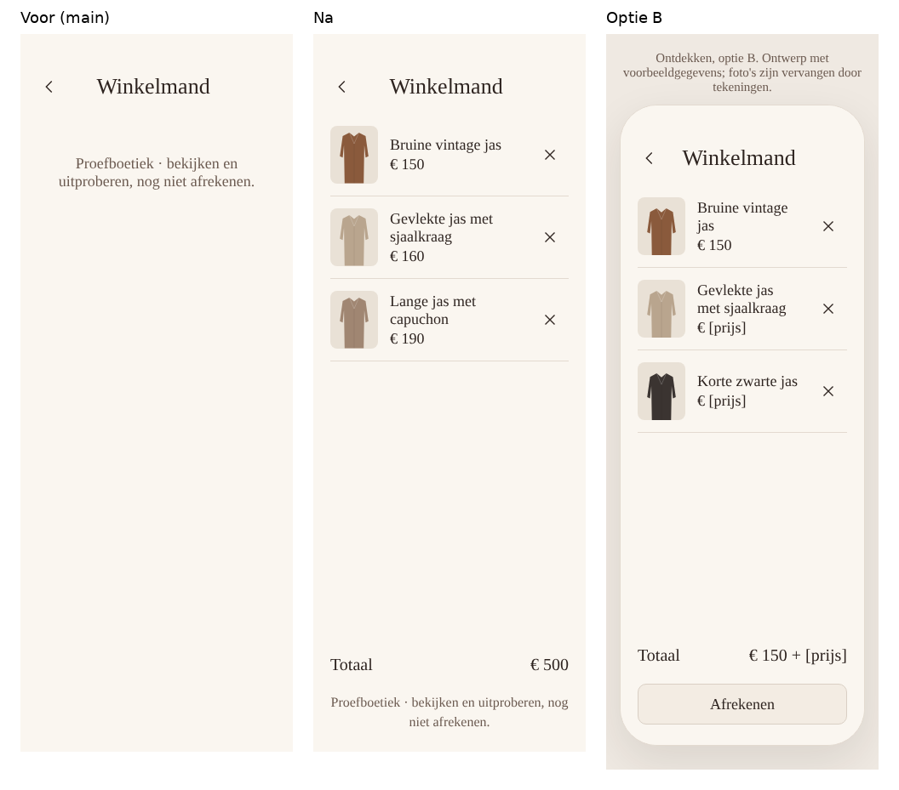

# Winkelmand — voor, na en optie B

Vastgelegd op 10 november 2026 in Chromium, bij viewports van 390 × 844 en 320 × 844 px. Links staat de goedgekeurde `main` 5bc7199 (alleen de proefmelding). In het midden staat dezelfde winkel met het ingevulde mandoverzicht. Rechts staat de referentie `concept/ontdekken-optie-b.html` met voorbeeldgegevens. Het verschil met optie B is bewust: de knop Afrekenen is vervangen door de bestaande proefmelding, omdat er nog geen checkout is.

De records en tekeningen komen uit de catalogus-testinterface. Er staan geen echte inventaris, privéfoto's, klantgegevens of fototokens in beeld. Externe fonts zijn geblokkeerd, dus alle kanten gebruiken de Georgia-terugval.

Opnieuw maken: `npm run build && npm run test:browser`. De browsertest schrijft `cart-<breedte>.png` en `reference-cart-<breedte>.png` naar `work/option-b-screenshots/`. Het voor-beeld is gemaakt met dezelfde test op `main`.
